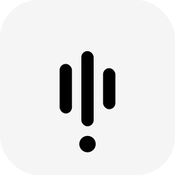

# LastStats

<p align="center">
  <picture>
    <source media="(prefers-color-scheme: dark)" srcset="app/src/main/assets/icons/app_logo_dark.png">
    
  </picture>
</p>

<p align="center">
  <a href="https://github.com/SanoBld/LastStats/releases"></a>
  <a href="https://github.com/SanoBld/LastStats/releases"></a>
  <a href="LICENSE"></a>
  <a href="https://discord.gg/JjqmkQgZBs"></a>
</p>

LastStats is a free app that shows what you really listen to. It reads your Last.fm history and turns it into stats, rankings, recaps and animated artist pages. It is written in Kotlin with Compose Multiplatform and Material 3 Expressive: one code base for Android, Windows, macOS, Linux and iPhone.

🌐 [Website](https://sanobld.github.io/LastStats/) · 💬 [Discord](https://discord.gg/JjqmkQgZBs)

---

## What you can do with it

- **Dashboard:** now playing, recent tracks, friends activity and a 60-day calendar.
- **Artist, album and track pages:** your stats, global stats, tags, popular tracks, translated biographies, lyrics, animated posters and a 3D flip cover.
- **Look back:** charts, multi-year heatmap, rankings, day-by-day history, and daily, weekly, monthly and yearly recaps you can share as images.
- **Friends:** follow Last.fm friends and get a music compatibility score by artists, genres, tracks and albums. Profile cards can carry a QR code.
- **Favorites:** love tracks, artists and albums, with folders and filters.
- **Achievements:** a level system based on your real listening.
- **Make it yours:** light, dark or AMOLED theme, your own accent color or dynamic color, 10 languages, notifications, home screen widgets, backups.

Everything comes from the Last.fm API (and ListenBrainz when you pick it as a source). Nothing is simulated.

---

## Install

Download from the [releases page](https://github.com/SanoBld/LastStats/releases):

| Platform | File |
|---|---|
| Android (most phones) | `app-arm64-v8a-release.apk` (or `app-universal-release.apk` if unsure) |
| Windows | `LastStats-Setup.exe` or `laststats-windows.zip` (ARM64: `-arm64`) |
| macOS | `LastStats-macos-arm64.dmg` (Apple silicon) or `LastStats-macos-x64.dmg` (Intel) |
| Linux | `LastStats.AppImage`, `laststats-linux.deb`, `laststats-linux.rpm` or `laststats-linux.zip` |
| iPhone / iPad | `LastStats.ipa` (unsigned: install it with AltStore or Sideloadly) |

If Android blocks the install, allow "Install unknown apps" for the app you opened the file with, then try again.

---

## Build from source

You need JDK 17 or newer. Android also needs the Android SDK (API 35). iOS needs a Mac with Xcode and XcodeGen.

```powershell
git clone https://github.com/SanoBld/LastStats.git
cd LastStats
.\gradlew.bat :app:assembleDebug          # Android APK
.\gradlew.bat :desktop:run                # desktop app on this computer
.\gradlew.bat :desktop:createDistributable # portable desktop app for this OS
```

iPhone (on a Mac): `cd iosApp && xcodegen generate`, then open `iosApp.xcodeproj` in Xcode.

Project layout: `shared/` (all the UI and logic, common code), `app/` (Android), `desktop/` (Windows, macOS, Linux), `iosApp/` (iPhone). Translations live in `app/src/main/res/values*/strings_l10n.xml`; run `python tools/gen_strings.py` after changing them.

---

## Project layout

```
app/src/main/kotlin/com/sanobld/laststats/
  core/        app state, constants, helpers
  data/        models, remote APIs, local storage, repositories
  domain/      taste, achievements, recap and library logic
  system/      notifications, workers, widgets, updates, backup, share
  ui/          theme, components, navigation, screens
app/src/main/res/   strings in 10 languages, widgets, icons, fonts
```

---

## Legal

**Independent project.** LastStats is not affiliated with or endorsed by Last.fm, Spotify, YouTube, Apple, Deezer, TheAudioDB, MusicBrainz, Wikipedia or GitHub. Their names and logos belong to their owners.

**Your data.** Everything stays on your device, and we keep no copy. The camera is only used to scan QR codes.

**License.** GNU GPL v3, © 2026 Sano Bld. See [LICENSE](LICENSE) and [NOTICE.md](NOTICE.md).

**AI.** AI helped with part of the development and with the in-app translations.
